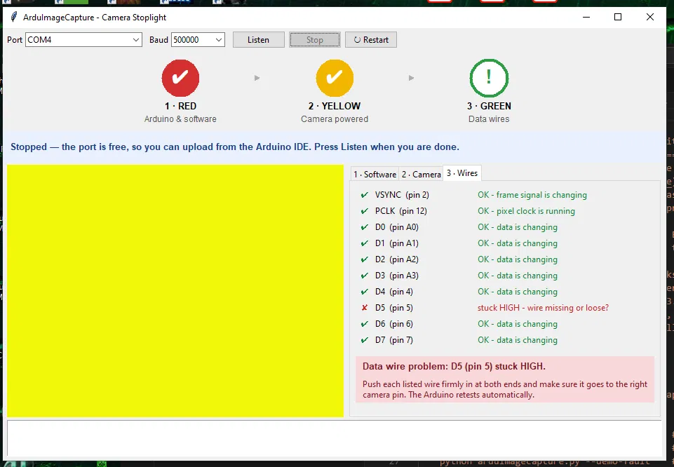

# OV7670 Camera Stoplight for Arduino Uno (Arduino IDE 2.x)

A classroom kit for getting an **OV7670 camera working with an Arduino Uno** and seeing the
picture on a PC, with a **red / yellow / green stoplight** that tells students exactly which
part of the build is wrong (software, camera power, or a specific data wire).


## Credit

This project is built on the work of **Indrek Luuk**. Please visit and star his repositories:

| Project | What it is |
|---|---|
| [LiveOV7670](https://github.com/indrekluuk/LiveOV7670) | The Arduino sketch and examples this kit is based on |
| LiveOV7670Library (inside the LiveOV7670 repo, `src/lib`) | The OV7670 camera library |
| [ArduImageCapture](https://github.com/indrekluuk/ArduImageCapture) | The original Java viewer for the serial picture stream |
| [Circuit Journal tutorial](https://circuitjournal.com/arduino-OV7670-to-pc) | Wiring and background |

**Why this repo exists:** the original ArduImageCapture viewer is a Java plug-in for the
Arduino IDE 1.x *Tools* menu. Arduino IDE 2.x has no such plug-in system, so this repo provides
a standalone **Python** viewer that reads the **same serial protocol**, plus small changes to
the sketch for the stoplight checks.

**What is NOT included:** the camera library itself. Students install it from Indrek's
repository (see Setup), so it stays under his terms and stays up to date.

## What is in this repo

| File | Origin |
|---|---|
| `arduimagecapture.py` | **New.** Python viewer + stoplight. Re-implements the serial protocol of the Java tool. |
| `sketch/ExampleUart.cpp` | **Modified copy** of Indrek's `ExampleUart.cpp` (details below) |
| `sketch/setup.h` | **Modified copy** of Indrek's `setup.h` (one line) |
| `docs/ExampleUart_changes.diff` | Every line that differs from Indrek's original `ExampleUart.cpp` |
| `requirements.txt` | Python packages: `pyserial`, `pillow` |

### What changed in the two sketch files

**`setup.h`** - one line: `#define EXAMPLE 1` became `#define EXAMPLE 3`. This selects the
serial (UART) example instead of the LCD example.

**`ExampleUart.cpp`** - Indrek's file is 623 lines; this copy adds about 320 lines and removes
14. All changes are in five blocks marked `STOPLIGHT CHANGE` (search the file for that text).
The camera-mode table (`UART_MODE` 1-17) and the picture-sending code are unchanged.

| Block | What it does |
|---|---|
| 1-2 | New yellow colour, a new message type (`0x04`, "checkpoint"), constants, prototypes |
| 3 | **Start-up checks** that replace the original single green/red test, see below |
| 4 | The "new picture" message now accepts any picture size (the checkpoint pictures are 40x30) |
| 5 | The new checkpoint message sent to the PC |

The 14 removed lines are the original green/red logic (`if (camera.init()) { green } else { red }`)
and the fixed-size picture-header lines.

### Do the changes only work with the new Python program?

- The checkpoint message and the *Recheck* button are understood **only by the Python viewer
  in this repo**. After a failed check the sketch waits for the viewer to press *Recheck*, so the
  original Java tool cannot be used with the modified sketch (not tested).
- The Python viewer should also work as a plain picture viewer with Indrek's **original**
  sketch, without the stoplight (not tested).
- The sketch and the viewer carry a matching version number (currently 2); a mismatch shows as a
  red "Stoplight sketch" row in the *Software* tab.

## The three stages

Each stage has its own checklist tab. When a stage fails, the Arduino stops and waits; fix the
problem, then press **Recheck** in the red message box.

| Light | Stage | Checks |
|---|---|---|
| RED | Software | Serial link, baud rate, sketch version, board and clock, selected mode, free memory |
| YELLOW | Camera powered | SIOD and SIOC lines (10K pull-ups, shorts), camera answers, camera ID, power (by elimination) |
| GREEN | Data wires | VSYNC, PCLK and **each of D0-D7 on its own line** (uses the camera's built-in colour bars) |

Limits: the wire check cannot see two data wires swapped (you would see wrong colours in the
live picture), and "camera is powered" means the camera answers over I2C - it does not measure
voltage.



## Setup

You need: Arduino Uno + OV7670 wired as in Indrek's
[README](https://github.com/indrekluuk/LiveOV7670#connections-for-arduino-unonano),
[Arduino IDE 2.x](https://www.arduino.cc/en/software), and Python 3.8 or newer.

1. **Libraries.** Download Indrek's [LiveOV7670](https://github.com/indrekluuk/LiveOV7670) as a ZIP.
   Copy the folder `src/lib/LiveOV7670Library` into your Arduino `libraries` folder
   (do **not** use *Add .ZIP Library* on the whole download - it will say "library not valid").
   In the Library Manager install **Adafruit GFX Library** (accept *Install all* so that
   **Adafruit BusIO** comes with it). Restart the IDE.
2. **Sketch.** Copy Indrek's `src/LiveOV7670` folder to e.g. `Documents/Arduino/LiveOV7670`, then
   replace its `ExampleUart.cpp` and `setup.h` with the two files from this repo's `sketch/` folder.
3. **Upload.** Open `LiveOV7670.ino`, choose *Arduino Uno* and your port, press Upload.
   Close the Serial Monitor afterwards.
4. **Viewer.** `pip install -r requirements.txt`, then `python arduimagecapture.py`.
   Pick the port, set **Baud** to the speed of your `UART_MODE` (mode 5 = 500000), press **Listen**.

Press **Stop** before uploading again. **Restart** starts over from the red light.

Try the viewer without any hardware:
`python arduimagecapture.py --demo` (also `--demo-fault`, `--demo-nocam`, `--demo-i2c`, `--demo-vga`, `--selftest`).

## Picture quality challenge (Uno)

Change `#define UART_MODE` near line 30 of `ExampleUart.cpp`, upload again, **and** set the same
baud rate in the viewer. Times are the minimum the serial link allows.

| Mode | Picture | Baud | About |
|---|---|---|---|
| 5 (default) | 320x240 colour | 500000 | 3 s per picture |
| 6 | 320x240 grey | 500000 | 1.5 s |
| 9 | 320x240 colour | 1000000 | 1.5 s |
| 11 | 640x480 grey | 1000000 | 3 s |

1000000 baud works on most modern Unos; some older ones cannot keep up (garbled or speckled
pictures - go back to a 500000 mode). Modes 12-17 use 2000000 baud and are meant for boards with
more speed and RAM, such as the Mega, not the Uno. In the viewer, **Picture: Large** shows
640x480 at full size. Focus matters more than resolution: turn the lens barrel while watching
the live picture.

## Standalone program (optional)

```
pip install pyserial pillow pyinstaller
pyinstaller --onefile --windowed --name ArduImageCapture arduimagecapture.py
```

Build on the kind of computer it will run on (Windows gives an `.exe`).

